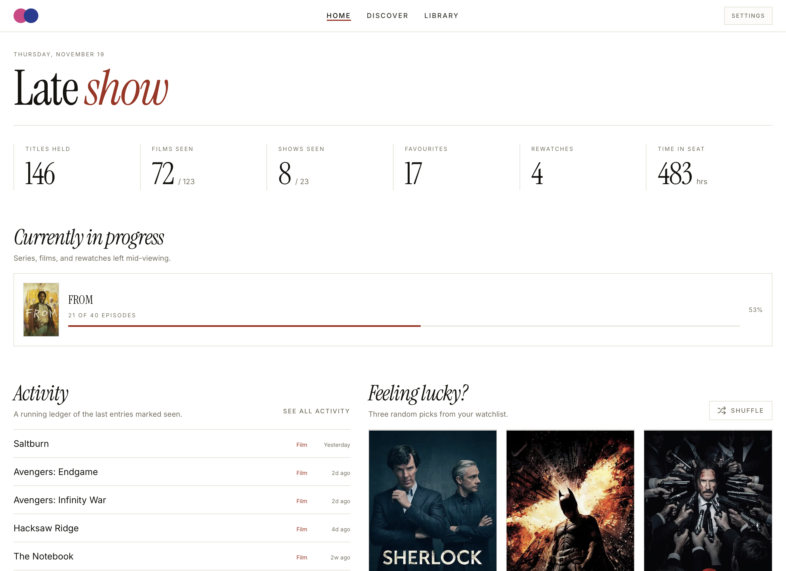
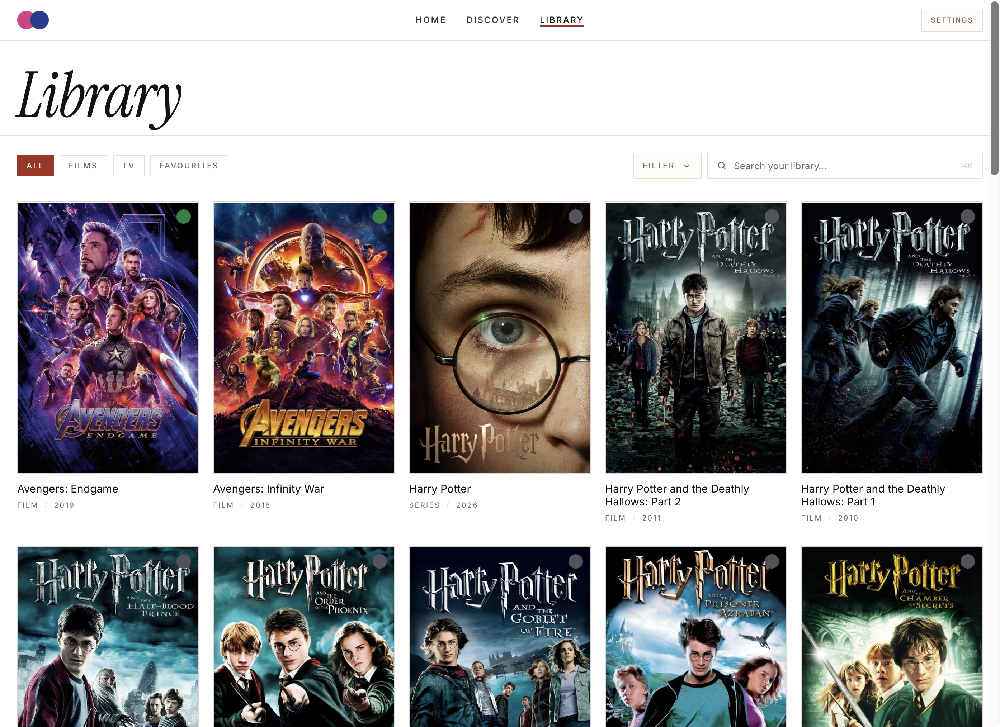
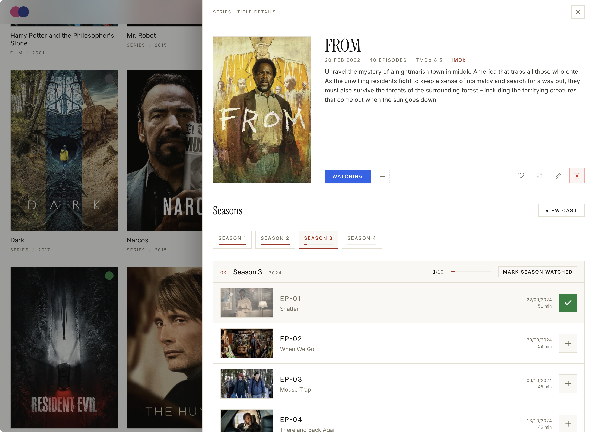
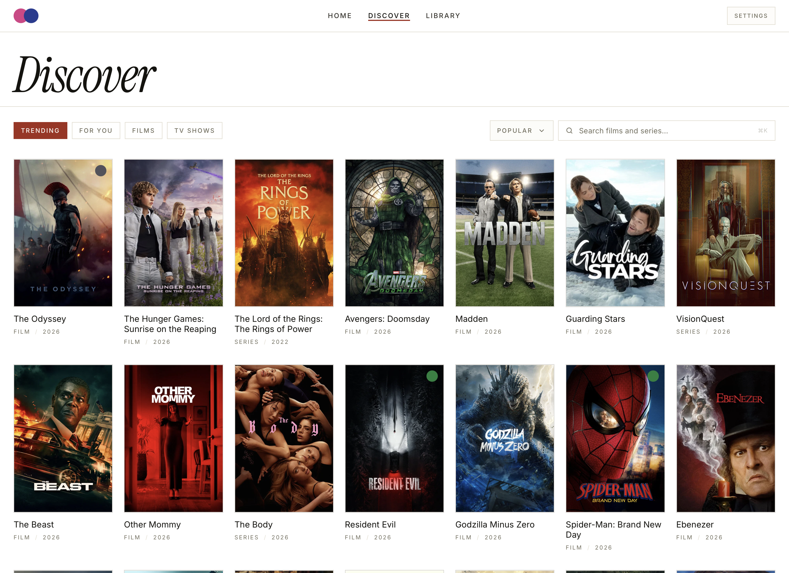

# CineTrack

A personal film and TV tracker that runs entirely on your own machine. No accounts, no social feeds, and no cloud sync — just a quiet, private space to keep track of everything you watch.

Most tracking apps turn movie-watching into a social feed filled with notifications, debates, and algorithms. CineTrack works like a personal cinema ledger: a simple, dependable notebook where you log what you have seen, track what is underway, and save what you want to watch next. Everything stays on your device.



## What you can do

- **Build your personal library.** Mark titles as Planned, Watching, Watched, or Dropped. Add ratings, favourites, watch dates, personal notes, and custom poster art.
- **Track TV series with care.** Tick off individual episodes or complete seasons. Rewatches are tracked on a separate timeline so your original viewing history remains untouched.
- **Find something good to watch.** Search TMDb, explore trending releases, browse by genre, and discover personalised "For You" picks based on your library.
- **Reflect on your habits.** The home overview features monthly charts, total hours watched, and a running activity log of recent viewings.
- **Tailor the presentation.** Switch between a light theme (Paper) and a dark theme (Noir), or follow your system preference.
- **Own your data completely.** Back up your entire library and preferences to a single JSON file anytime, or restore it without losing existing entries.



## How it works

CineTrack is a lightweight local web app. Your records are saved directly to a small SQLite database on your computer (`data/database.sqlite`), never to an external cloud service. Title details and poster artwork are fetched from [The Movie Database (TMDb)](https://www.themoviedb.org/) through a local proxy, so your API key stays private.

Every change is saved safely using atomic file swaps, protecting your data if your computer shuts down unexpectedly. A fresh backup is also created whenever the server starts.



## Getting started

You will need **Node.js 22.18+** and a free [TMDb API key](https://www.themoviedb.org/settings/api).

```bash
# Install dependencies
npm install

# Add your TMDb API key
cp .env.example .env

# Start CineTrack locally
npm run dev
```

Open [127.0.0.1:8443](http://127.0.0.1:8443) in your browser. To create an optimized production build, run `npm run build` followed by `npm run start`.



## Built with

Built with React 19, TypeScript, Vite, Tailwind CSS, and sql.js. All typography is bundled locally, so the app makes no external network requests other than fetching TMDb metadata and artwork.

## Acknowledgements

This product uses the TMDb API but is not endorsed or certified by TMDb.
