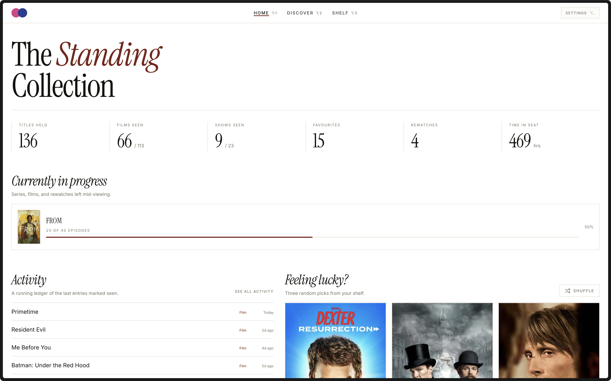
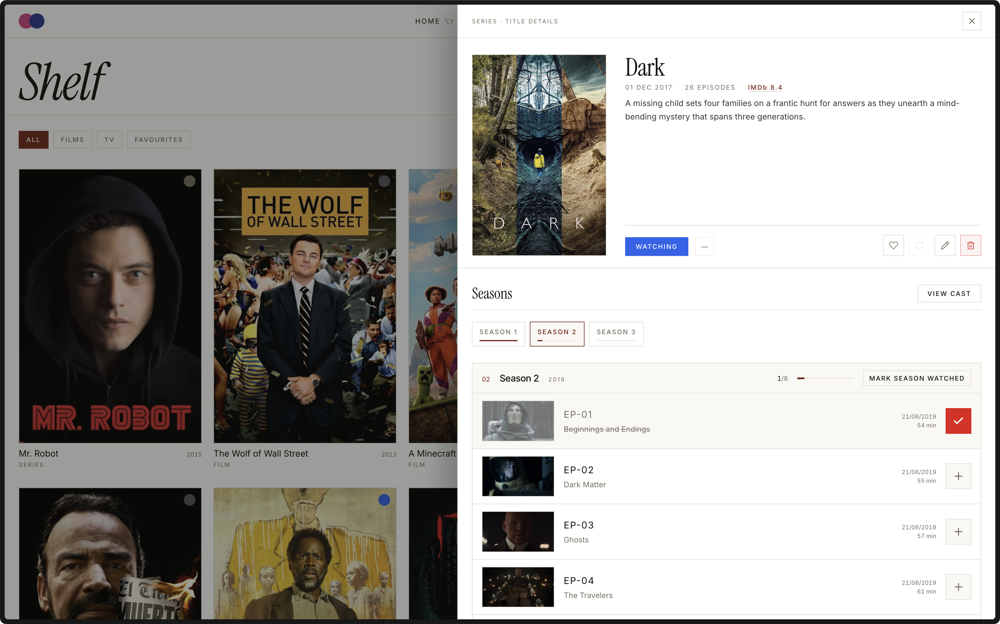

# CineTrack

CineTrack is a personal home for everything you watch. Track films and TV shows, log episodes, and look back on your viewing history whenever you like. It is built as a quiet alternative to busy social trackers — more like a personal cinema ledger. There are no accounts, no feeds, and no noise — everything stays on your own device.



## What it does

- **Build your library.** Mark titles as Planned, Watching, Watched, or Dropped.
- **Track TV properly.** Tick off single episodes or whole seasons, and follow rewatches separately.
- **Make it personal.** Add ratings, favourites, notes, watch dates, and even your own poster images.
- **Discover new things.** Search TMDb, browse what's trending, and get "For You" picks based on your library.
- **See your habits.** The home dashboard shows monthly charts, hours watched, and title counts.
- **Make it yours.** Switch between the light Paper theme and the dark Noir theme, or follow your system setting, and adjust the layout.
- **Stay portable.** Export a full backup (library and preferences) to a JSON file, or restore one, from Settings.



## How it works

CineTrack is a local web app. Your library lives in a small SQLite database inside the project folder (`data/database.sqlite`), not on a remote server. Title information comes from The Movie Database (TMDb) through a local proxy, so your API key never reaches the browser; posters load directly from TMDb's image servers.

- **Saves are durable.** Every change is written to a temporary file and atomically swapped in, so a crash or power cut can't leave a half-written database. A restore point (`data/database.sqlite.bak`) is taken each time the server starts.
- **Damage is never overwritten.** If the database file fails SQLite's integrity check, CineTrack refuses to read or write it and tells you, rather than starting over with an empty library.
- **One server per library.** A lock file stops two CineTrack servers (say `npm run dev` and `npm run start`) from writing the same database.
- **Save status is visible.** The header shows when a save is slow or failing, and the browser warns before closing a tab with unsaved changes.

Your records are also portable: Settings can export the whole library and your preferences to a JSON backup and restore it later. Restoring merges into the current library; it never deletes anything.

## Built with

React 19, TypeScript, Vite, Tailwind CSS, and sql.js for the local database, with metadata and posters from TMDb. Fonts are bundled, so the app makes no third-party requests besides TMDb.

## Getting started

You need two things: Node.js 22.18 or newer, and a free [TMDb API key](https://www.themoviedb.org/settings/api).

1. Install the dependencies:

   ```bash
   npm install
   ```

2. Copy `.env.example` to `.env` and add your key (a v3 API key or a v4 read access token both work):

   ```env
   TMDB_KEY=your_api_key_here
   ```

   On macOS and Linux, keep the file private to your account:

   ```bash
   chmod 600 .env
   ```

3. Start the app:

   ```bash
   npm run dev
   ```

Then open <http://127.0.0.1:8443>. To run the optimized build instead, use `npm run build` followed by `npm run start`.

### Configuration

| Variable | Default | Purpose |
| --- | --- | --- |
| `TMDB_KEY` | — | TMDb credential, read from the environment, `.env.local` or `.env` (a legacy `API.txt` file also works). Changes are picked up within a few seconds. |
| `PORT` | `8443` | Port for `npm run dev` and `npm run start`. |
| `CINETRACK_DATA_DIR` | `./data` | Folder for the database. Must be outside the project folder (or exactly `./data`) so it can never be served or bundled. |

## Security model

CineTrack is a single-user app for your own machine. The server listens only on `127.0.0.1`, accepts requests only from loopback addresses with a local `Host` header (blocking DNS-rebinding attacks), and requires same-origin requests for every API call, so other websites can neither read nor change your library. It does not authenticate other programs or user accounts running on the same computer; don't run it on a shared machine you don't trust.

The TMDb proxy only allows read-only requests to a fixed set of endpoints and parameters, never follows redirects, and caches responses. The production build ships with a strict Content Security Policy.

## Development

| Command | What it does |
| --- | --- |
| `npm run dev` | Development server with hot reload. |
| `npm test` | Unit tests plus integration tests for the local API (run against a throwaway database). |
| `npm run lint` | ESLint, including the React Hooks rules. |
| `npm run typecheck` | Type-checks the app (`tsconfig.json`) and the server, config and tests (`tsconfig.node.json`). |
| `npm run verify` | All of the above, then a production build. |

Code layout:

- `src/` — the React app. `src/lib/entry.ts` defines a library record and its validation, shared by the browser and the server.
- `server/` — the local API (`api.ts`), SQLite storage (`database.ts`), library and settings routes, and the TMDb proxy, mounted into Vite by `plugin.ts`.
- `test/` — `node:test` suites; no extra test framework needed.

## Acknowledgements

This product uses the TMDb API but is not endorsed or certified by TMDb in any way.